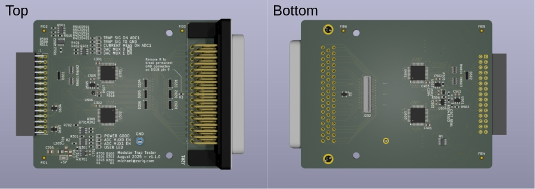
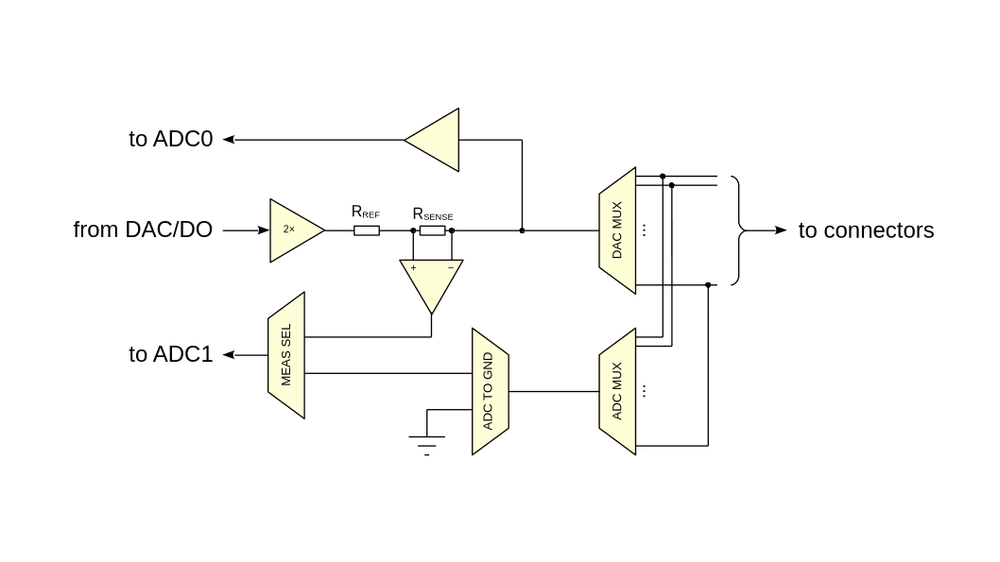
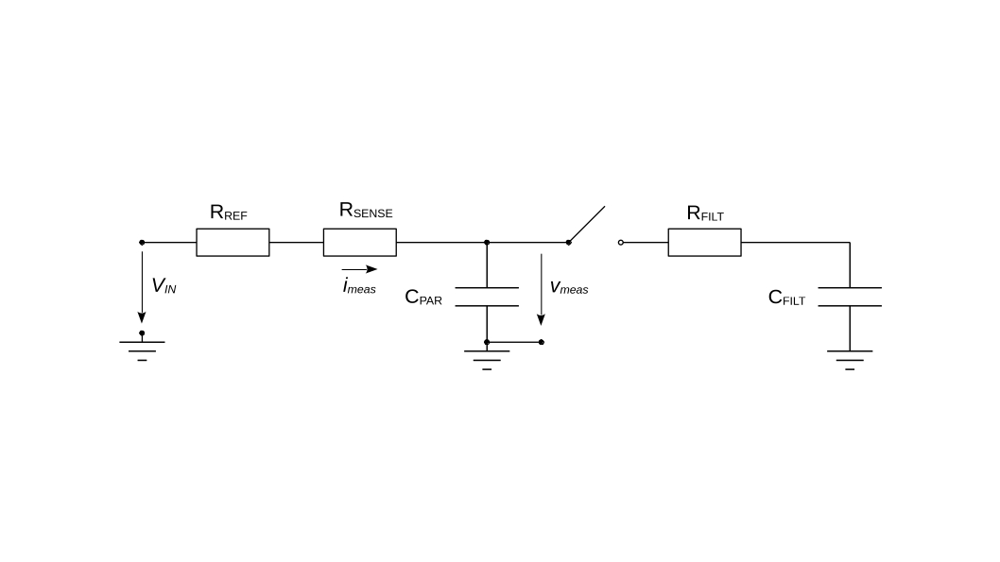
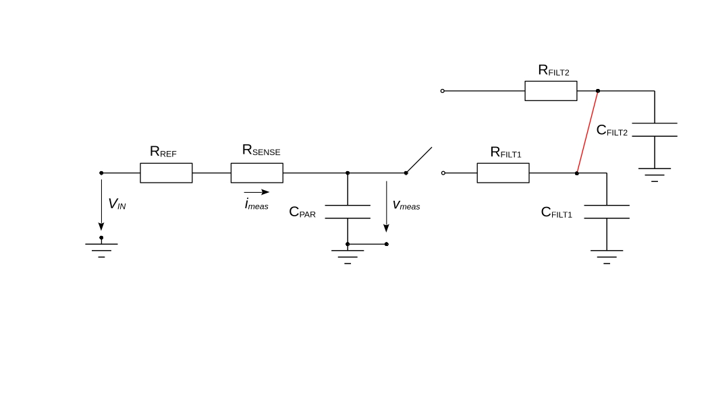
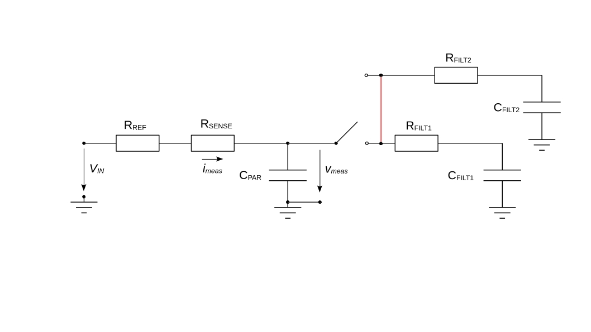

# Analog Frontend

This repository contains the design files for the analog frontend (AFE) of the Modular Trap Testing device. This iteration of the tester has been designed as an accessory for the [Analog Discovery 3 (and 2)](https://digilent.com/reference/test-and-measurement/analog-discovery-3/start). The main goal of the trap tester is to automate debugging measurements which usually have been performed with a multimeter by hand. The scripts to control the AD2 or AD3 which (partially) achieve this goal can be found in [this repository](../getting-started.md).

In the context of trapped ions these measurements have been:

* finding shorts from a trap electrode to signal ground
* identifying shorts between electrodes
* making sure the cryogenic wiring is working up to the in-vacuum low-pass filters
* providing a full connection matrix of the in-chamber wiring

A lot of inspiration has been taken from a non-modular design by [Roger Serrat](https://ethz.ch/content/dam/ethz/special-interest/phys/quantum-electronics/tiqi-dam/documents/semester_theses/semesterthesis_Roger_Serrat).

The front-end will plug into a DSUB-50 vacuum feedthrough. Alternatively, the trap tester can be connected to another board using an FPC. (FPC Connector: [Molex - 502598-5193](https://www.molex.com/en-us/products/part-detail/5025985193)) This connector can be found on the bottom side of the AFE.

However, the frontend was designed in such a way that less capable devices are able to use the board with minor modifications. The only requirements for the data acquisition module are:

* 16 GPIO (digital) pins for configuration of the AFE
* one DAC or additional GPIO channel to "excite" the system
* 2 ADC channels
* 5V power rail for powering the daughter board.

The ADCs should be able to sample at about ~1MSPS.

## Simplified Schematic

The signal chain on the board is as follows:

* The DAC or digital output is buffered and amplified by a factor of 2.
* The buffer stage output puts a current limiting resistor $R_{\text{REF}} = 10\text{k}\Omega$ and a current sense resistor $R_{\text{SENSE}} = 470\Omega$ in series before the signal goes to the MUX bank. Together they form the source resistance $R_{\text{SOURCE}} = R_{\text{REF}} + R_{\text{SENSE}} = 10470\Omega$ that every formula below uses. This makes it possible to connect the DAC output to any of the pins of chosen connectors (here: DSUB50 and Molex FPC)
* The voltage at the DAC MUX input is buffered and fed to ADCO.
* ADC1 can be driven by one of two signal (using another MUX/switch)
    * The ADC MUX bank enables the user to connect any of the connector pins **independently** of the DAC MUX. This can be used to detect shorts between electrodes.
    * The current sense circuit allows for precision current measurements. The voltage output of the sense circuitry is $25 \frac{V}{V} i_{\text{SENSE}} R_{\text{SENSE}}$. The choice of current sense amplifier allows for $R_{\text{SENSE}} \leq 500 \Omega$. In the standard configuration, $1 \mu \text{A}$ leads to an output voltage of $1 \mu \text{A} \times 25 \times 470\Omega = 11.75\text{mV}$ which is considerable. **The current sense can only detect positive currents!**

## Analog Frontend Equivalent Model

The frontend is well described by a RC low-pass filter. The low-pass comes from the reference and sense resistors and the parasitics of the components and PCB layout. It is heavily dominated by the input capacitance of the MUXes. If we connect a filter board to the frontend we get a concatenation of two first order RC low-pass filters. We however can only access the voltage at the node between the low-pass filters.

The MUX can disconnect the filter board acting like a software-controllable switch.

## Modes of Operation

In the following we will describe how the measurements can be used to get estimates for quantities of interest.

### Measuring Voltages

It should be apparent from the schematic that one can use the tester as a voltage meter.

**The input range is 0V to 5V.** Any voltage outside this range on a connector pin, negative voltages included, permanently damages the trap tester. Never connect the tester to signals that can leave this range, such as the outputs of the electrode driving DACs (e.g. the Fastino, which swings up to $\pm 10\text{V}$).

It can also be used to assess whether trap electrodes are shorted together. If applying a voltage to one electrode leads to a driven/stable voltage at a different electrode one can conclude that there is a low-ish impedance connection between them. As DAC and ADC MUX are independent, this device can perform this measurement even for signals within the signals grouped into one feedthrough connector.

### Measuring DC Resistances

There are many ways to measure the DC resistance of an attached load. Assuming $R_{\text{FILT}}$ is connected to GND (replace $C_{\text{FILT}}$ with a short) we get:

1. Use the voltage divider formula: $v_{\text{meas}} = V_{\text{IN}} \frac{R_{\text{FILT}}}{R_{\text{FILT}}+R_{\text{SOURCE}}}$
2. Use the current measurement: $i_{\text{meas}} = \frac{V_{\text{IN}}}{R_{\text{FILT}}+R_{\text{SOURCE}}}$
3. Or both: $R_{\text{FILT}} = \frac{v_{\text{meas}}}{i_{\text{meas}}}$

### Measuring Capacitances

The capacitance is defined as $C = \frac{Q}{V}$.
Assuming the capacitors (parasitics and actual components) are discharged at the beginning of the measurement we can estimate the total capacitance by applying a step $V_{\text{IN}}$ at the input and integrate the current over time:

$C_{\text{tot}} = \frac{1}{V_{\text{IN}}} \int_{t = t_0}^{\infty} i_{\text{meas}}(t) dt$

which can be approximated using numerical integration with a finite time horizon:

$C_{\text{tot}} = \frac{1}{V_{\text{IN}} f_{\text{sample}}} \Sigma_{k = 0}^{\text{buffer size} - 1} i_{\text{meas}}[k]$

Performing the baseline measurement once with the switch open allows for estimating the parasitic capacitance. As the measurement is independent of the resistors ($R_{\text{SENSE}}$ can be arbitrary but known for the current estimate) one can substract the baseline capacitance $C_{\text{tot, baseline}} = C_{\text{PAR}}$ from the filter measurement to get an estimate of $C_{\text{FILT}} = C_{\text{tot, switch closed}}$ - $C_{\text{tot, baseline}}$

In initial tests, this method produces surprisingly accurate estimates (to about 5%). If this holds true in the general still needs to be investigated.

### Measuring Attached RC low-pass Filters

We assume that the switch is closed. In this case, the transfer function from $V_{\text{IN}}$ to $v_{\text{meas}}$ is given by:

$\frac{v_{\text{meas}}}{V_{\text{IN}}} (s) = \frac{1 + s \tau_2}{s^2 \tau_1 \tau_2 + s (\tau_1 + \tau_2 + \tau_3) + 1}$

where:

* $\tau_1 = R_\text{SOURCE}  C_{\text{PAR}}$
* $\tau_2 = R_\text{FILT}  C_{\text{FILT}}$
* $\tau_3 = R_{\text{SOURCE}} C_{\text{FILT}}$

The step response (unit step) is then given by:

$v_{\text{meas}}(t) = L^{-1}((\frac{1}{s}) \frac{v_{\text{meas}}}{V_{\text{IN}}}(s))(t)$

where $L^{-1}(.)(t)$ is the inverse Laplace transfrom.

For _convenience_ we define:

* $T = \sqrt{\tau_1^2 + \tau_2^2 + \tau_3^2 - 2 (\tau_1 \tau_2 - \tau_1 \tau_3 -\tau_2 \tau_3)}$
* $\alpha = \frac{T}{\tau_1 \tau_2}$
* $\beta = \frac{1}{2 \tau_2} (1 + \frac{T + \tau_2 + \tau_3}{\tau_1})$
* $A = T - \tau_1 + \tau_2 - \tau_3$
* $B = T + \tau_1 - \tau_2 + \tau_3 = 2T - A$

If we perform a step from 0V to $V_{\text{in}}$ we get

$v_{\text{meas}}(t) = V_{\text{in}} (1 - \frac{A}{2T}e^{-\beta t} - \frac{B}{2T}e^{-(\beta - \alpha)t})$

We can then fit our measurement trace to the analytical solution to get an estimate for $R_\text{FILT}$ and $C_{\text{FILT}}$. We note that $R_\text{FILT}$ does not appear isolated in the expression. It only appears in the time constant of the filter board low-pass filter. Therefore, it is more accurate to say that one can infer $\tau_2$ from the fit. From the independent capacitance measurement one can then arrive at an estimate of $R_\text{FILT}$.

## Debugging Common Faults

### Health of In-Chamber Wiring

To assess if the wiring up to the filter board is nominal one simply has to measure the attached low-pass filter. Detecting the filter capacitance is usually indicative enough. Note that passive components behave differently in cryogenic environments compared to room temperature. Performing measurements of the filters during initial cooldown are recommended to better judge the health of the system.

### Electrode Shorts to GND

This can be easily checked: If the analog frontend is able to drive a DC current through the signal channel then the electrode is connected to GND. The DC resistance can then be estimated using any method outlined in section [Measuring DC Resistances](#measuring-dc-resistances). An ideal electrode short would lead to measuring the filter resistor. Any other value hints at a more involved issue.

### Wiring Shorts

A short to ground before the RC low-pass can be detected using a DC resistance measurement. We note here that the only accurate way to measure very low impedance shorts with this device is to use the current method as outlined in [Measuring DC Resistances](#measuring-dc-resistances).

### Shorts between Electrodes

For a short between two electrodes after the filter we have the following schematic:

Essentially, the tester will charge both filter capacitors. The result would be that instead of measuring $C_{\text{FILT1}}$ we would measure $C_{\text{FILT1}} + C_{\text{FILT2}}$ while the filter resistance does not change.
This measurement alone does not strictly reveal which electrodes are shorted together. It can be any one in the set of electrodes which also produce the same off-nominal filter board parameter estimates. Hopefully, this greatly reduces the possible combinations. One can then use geometric (pairs of physically close electrodes or filter board channels) arguements to check which electrodes are most likely to be shorted.

Similar arguments can be made about larger groups of shorted electrodes.

### Shorts on the Filter Board or Wiring Faults

The modified schematic is the following:

As in the case for shorts between electrodes, we charge both filter capacitors. The measured resistance / time constant (strictly speaking: the fitted values) will also change, however.

If $C_{\text{FILT1}} = C_{\text{FILT2}}$ and $R_{\text{FILT1}} = R_{\text{FILT2}}$ (which often is the case) we can argue by the symmetry of the RC branches that the voltage over $C_{\text{FILT1}}$ mirrors the one over $C_{\text{FILT2}}$.
Effectively, we therefore see both Rs and Cs in parallel (halfing the resistance but doubling the capacitance). This leaves the time constant (for this situation the model is still valid and this can be considered an actual time constant $\tau_2$) unchanged.
